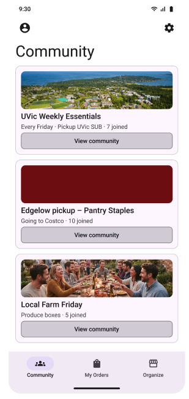
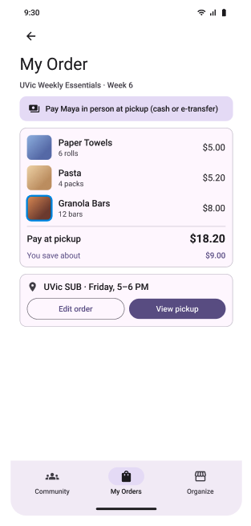
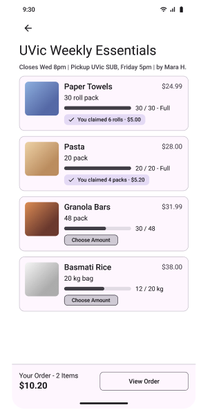
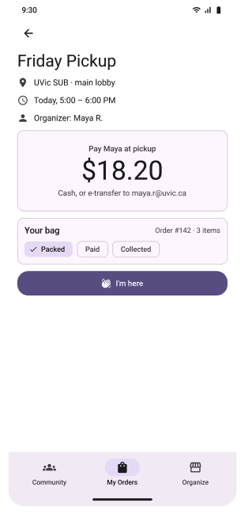
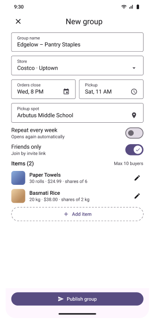

# POOLD - Your Shares, Shared

This is the Github page for the POOLD project. POOLD is a mobile-first app that helps a group organizer coordinate bulk grocery and household purchases, with other people joining the group to split the cost and the product. Everyone wants to pay less for groceries, but due to storage space, sometimes less is more.

For Quick Access to the Backlog of this Project, see [here](https://github.com/users/BluArch/projects/4)

This project is currently in the form of an MVP, to access this MVP, find it on [Figma](https://www.figma.com/design/pUkAndNcVv3pBQpuhgTten/SENG455-M2-Medium-Fid-prototype?node-id=0-1&p=f&t=WPyAjZokRCkk2Dv6-0) and press Present (or opt cmd Enter)

# Join Community Groups

Join others in your community on bulk order trips, it's the lower price with the portion sizes you want!

# Take Your Share

See what others are ordering and grab only what you want!

  

# Create Your Own Group

Not seeing something you're needing? Make your own group and organize a bulk order trip!

